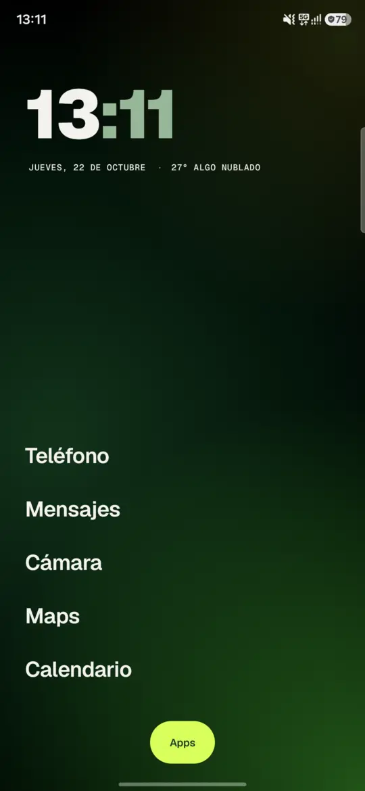
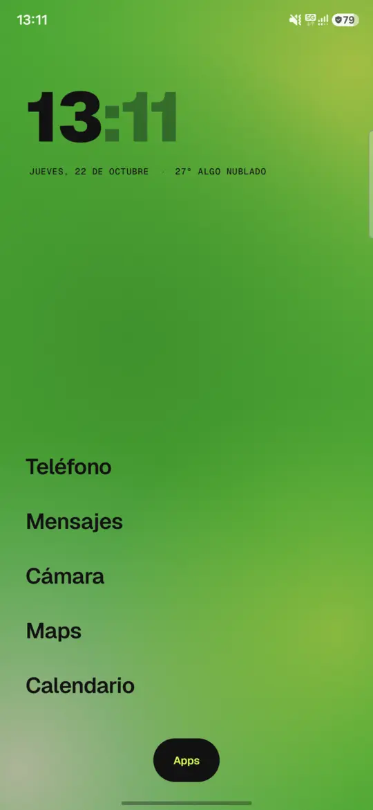
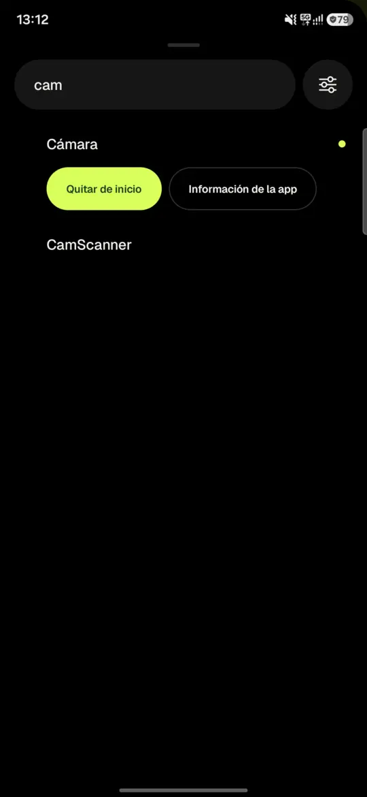
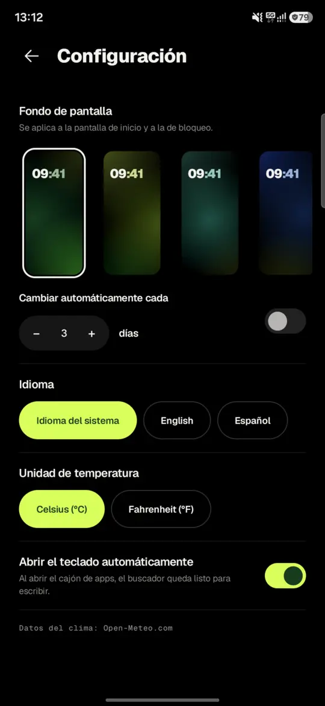

<p align="center">
  
</p>

<h1 align="center">Fresh Launcher</h1>

<p align="center">
  Una pantalla de inicio minimalista y fresca para Android: un reloj grande, el clima y unas pocas favoritas.<br>
  Todo lo demás está a un deslizamiento de distancia.
</p>

<p align="center"><strong>Sin anuncios · Sin rastreo · Sin cuentas</strong></p>

<p align="center">
  <a href="README.md">English</a> ·
  <a href="LICENSE">Licencia MIT</a> ·
  <a href="DESIGN.md">Notas de diseño</a>
</p>

<p align="center">
  
  
  
  
</p>

## Funciones

- **Reloj en dos tonos**, con la fecha y el clima actual debajo.
- **Hasta 7 favoritas** en texto. Mantené presionada y arrastrá para reordenar, o mantené presionada y soltá para quitarla.
- **Cajón de apps**: deslizá hacia arriba (o tocá *Apps*). La búsqueda ignora tildes y mayúsculas, así que `camara` encuentra *Cámara*. Con *Ir* en el teclado se abre el primer resultado.
- **7 fondos con degradé difuso**, con variante clara y oscura que sigue el tema del sistema. También pueden cambiar solos cada 1 a 30 días.
- **Configuración**: idioma por app (Android 13+), °C o °F, y si el teclado se abre junto con el cajón.
- **Inglés y español**, formato de 12 o 24 horas del sistema, y respeta *Quitar animaciones*.
- **Sin cuentas, publicidad ni analíticas.**

## Requisitos

- Android 8.0 (API 26) o posterior. Probado en un Samsung Galaxy A56 con Android 16.
- El idioma por app necesita Android 13 o posterior.

## Compilar desde el código

Necesitás **JDK 17 o posterior** y el **Android SDK** con la plataforma 37.

```bash
git clone https://github.com/JuanFer-NL/fresh-launcher.git
cd fresh-launcher
./gradlew assembleDebug        # app/build/outputs/apk/debug/app-debug.apk
./gradlew testDebugUnitTest lintDebug
```

Instalá la APK, tocá el botón de inicio y elegí **Fresh Launcher** (o configuralo en *Ajustes → Aplicaciones → Aplicaciones predeterminadas → Aplicación de inicio*).

La versión debug se instala junto a la release como `com.fresh.launcher.debug`. Para probar el tema o una letra más grande sin tocar los ajustes del teléfono:

```bash
adb shell am start -n com.fresh.launcher.debug/com.fresh.launcher.MainActivity --es theme light --ef font_scale 1.3
```

### Versión release firmada

Copiá [`keystore.properties.example`](keystore.properties.example) como `keystore.properties` (está en `.gitignore`), apuntalo a tu clave de firma y ejecutá:

```bash
./gradlew assembleRelease      # app/build/outputs/apk/release/app-release.apk
```

Sin `keystore.properties`, la release se genera sin firmar.

## Permisos y privacidad

| Permiso | Para qué |
|---|---|
| `<queries>` para actividades de launcher (sin `QUERY_ALL_PACKAGES`) | Listar las apps que podés abrir, y nada más. |
| `ACCESS_COARSE_LOCATION` | Solo para el clima, y solo después de tocar *Tocá para ver el clima*. Las coordenadas se redondean a dos decimales (~1 km) antes de enviarse a [Open-Meteo](https://open-meteo.com/). |
| `INTERNET` | La consulta del clima a Open-Meteo. No se envía nada más a ningún lado. |
| `SET_WALLPAPER` | El degradé elegido se pone como **fondo de pantalla del sistema, en inicio y bloqueo**. Así Android usa su transición nativa de "volver al inicio". Si después ponés un fondo propio, el launcher lo respeta salvo que vuelvas a elegir uno de sus degradés. |

## Limitaciones conocidas

- Android no les da a los launchers de terceros la animación del gesto de inicio del sistema. Fresh Launcher hace su propio zoom corto, pero en algunos equipos la transición puede verse menos fluida que con el launcher de fábrica (pasa lo mismo con otros launchers de terceros).
- Algunos Samsung oscurecen el fondo de pantalla en modo oscuro, y los degradés claros se ven más apagados.

## Estructura

```
app/src/main/java/com/fresh/launcher/
├── MainActivity.kt      # Estado, gestos, cajón y ciclo de vida
├── AppRepository.kt     # Apps instaladas, abrirlas y guardar favoritas
├── Settings.kt          # Configuración e idioma por app
├── Weather.kt           # Cliente de Open-Meteo y ubicación
└── ui/                  # Tema, inicio, cajón, configuración, fondos e íconos
```

## Contribuir

Los issues y pull requests son bienvenidos. En [CONTRIBUTING.md](CONTRIBUTING.md) está cómo compilar, probar y agregar traducciones o fondos, y los issues con la etiqueta [good first issue](https://github.com/JuanFer-NL/fresh-launcher/labels/good%20first%20issue) son un buen punto de partida. Las preguntas e ideas van en [Discussions](https://github.com/JuanFer-NL/fresh-launcher/discussions).

## Créditos

- [Geist y Geist Mono](https://github.com/vercel/geist-font) de Vercel, bajo la SIL Open Font License 1.1 (incluidas en `app/src/main/res/font`, con su licencia en `app/src/main/assets/licenses`).
- Datos del clima de [Open-Meteo.com](https://open-meteo.com/), bajo CC BY 4.0. La API gratuita de Open-Meteo es para uso no comercial; revisá [sus términos](https://open-meteo.com/en/terms) antes de distribuir una versión comercial.
- La dirección visual se inspiró en la identidad de marca pública de Lemon Cash y en algunas referencias de diseño listadas en [DESIGN.md](DESIGN.md). Fresh Launcher es un proyecto independiente y no tiene relación con ninguna de ellas ni cuenta con su aval.

## Licencia

[MIT](LICENSE) © 2026 JuanFer-NL
