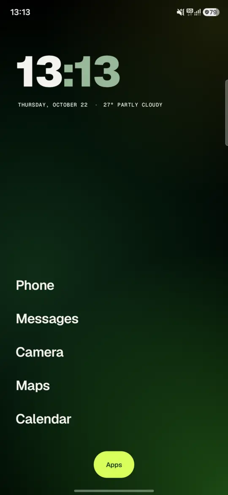
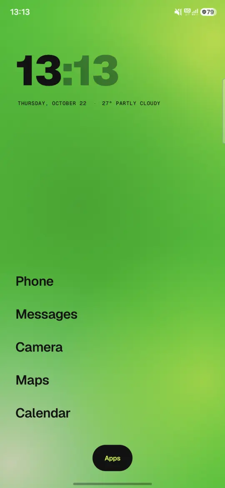
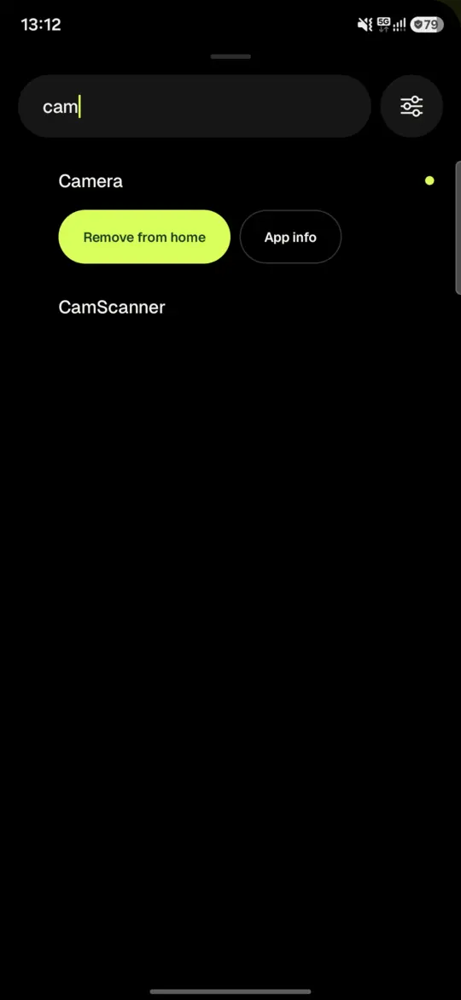
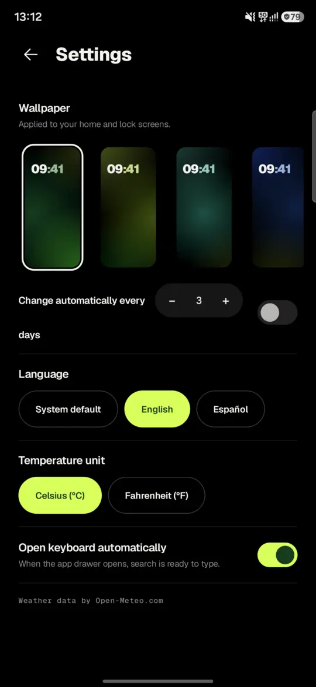

<p align="center">
  
</p>

<h1 align="center">Fresh Launcher</h1>

<p align="center">
  A minimal, fresh home screen for Android: a big clock, the weather and a handful of favorites.<br>
  Everything else is one swipe away.
</p>

<p align="center">
  <a href="README.es.md">Español</a> ·
  <a href="LICENSE">MIT License</a> ·
  <a href="DESIGN.md">Design notes (Spanish)</a>
</p>

<p align="center">
  
  
  
  
</p>

## Features

- **Two-tone clock** with the date and current weather underneath.
- **Up to 7 favorites** as plain text. Long-press and drag to reorder, or long-press and release to remove.
- **App drawer**: swipe up (or tap *Apps*). The search ignores accents and case, so `camara` finds *Cámara*. Press *Go* on the keyboard to open the first result.
- **7 mesh-gradient wallpapers** with light and dark variants that follow the system theme. They can also rotate automatically every 1–30 days.
- **Settings**: per-app language (Android 13+), °C or °F, and whether the keyboard opens with the drawer.
- **English and Spanish**, 12/24-hour time from the system, and *Remove animations* is respected.
- **No accounts, ads or analytics.**

## Requirements

- Android 8.0 (API 26) or later. Tested on a Samsung Galaxy A56 with Android 16.
- Per-app language needs Android 13 or later.

## Build from source

You need **JDK 17 or later** and the **Android SDK** with platform 37.

```bash
git clone https://github.com/JuanFer-NL/fresh-launcher.git
cd fresh-launcher
./gradlew assembleDebug        # app/build/outputs/apk/debug/app-debug.apk
./gradlew testDebugUnitTest lintDebug
```

Install the APK, press the home button and choose **Fresh Launcher** (or set it in *Settings → Apps → Default apps → Home app*).

The debug build installs next to a release build as `com.fresh.launcher.debug`. To try the theme or a larger font without touching the phone's settings, start the debug build with:

```bash
adb shell am start -n com.fresh.launcher.debug/com.fresh.launcher.MainActivity --es theme light --ef font_scale 1.3
```

### Signed release

Copy [`keystore.properties.example`](keystore.properties.example) to `keystore.properties` (it is git-ignored), point it at your keystore and run:

```bash
./gradlew assembleRelease      # app/build/outputs/apk/release/app-release.apk
```

Without `keystore.properties` the release build is produced unsigned.

## Permissions and privacy

| Permission | Why |
|---|---|
| `<queries>` for launcher activities (no `QUERY_ALL_PACKAGES`) | To list the apps you can open, and nothing else. |
| `ACCESS_COARSE_LOCATION` | Only for the weather, and only after you tap *Tap for weather*. Coordinates are rounded to two decimals (~1 km) before being sent to [Open-Meteo](https://open-meteo.com/). |
| `INTERNET` | The weather request to Open-Meteo. Nothing else is sent anywhere. |
| `SET_WALLPAPER` | The chosen gradient is set as the **system wallpaper on both the home and lock screens**. This lets Android use its native "back to home" transition. If you later set a wallpaper of your own, the launcher keeps it unless you pick one of its gradients again. |

## Known limitations

- Android does not give third-party launchers the system's home-gesture animation. Fresh Launcher plays its own short zoom-in instead, but the hand-off may look less fluid than the stock launcher on some devices (the same happens with other third-party launchers).
- Some Samsung devices dim the wallpaper in dark mode, which makes the light gradients look darker.

## Project layout

```
app/src/main/java/com/fresh/launcher/
├── MainActivity.kt      # State, gestures, drawer, lifecycle
├── AppRepository.kt     # Installed apps, launching, favorites storage
├── Settings.kt          # Settings storage and per-app language
├── Weather.kt           # Open-Meteo client and location
└── ui/                  # Theme, home, drawer, settings, wallpapers, icons
```

## Contributing

Issues and pull requests are welcome. Please run `./gradlew testDebugUnitTest lintDebug` before opening a PR. CI runs the same checks on every push.

## Credits

- [Geist and Geist Mono](https://github.com/vercel/geist-font) by Vercel, under the SIL Open Font License 1.1 (bundled in `app/src/main/res/font`, license in `app/src/main/assets/licenses`).
- Weather data by [Open-Meteo.com](https://open-meteo.com/), under CC BY 4.0. Open-Meteo's free API is meant for non-commercial use; check [their terms](https://open-meteo.com/en/terms) before shipping a commercial build.
- The visual direction was inspired by the public brand identity of Lemon Cash and a few design references listed in [DESIGN.md](DESIGN.md). Fresh Launcher is an independent project and is not affiliated with or endorsed by any of them.

## License

[MIT](LICENSE) © 2026 JuanFer-NL
